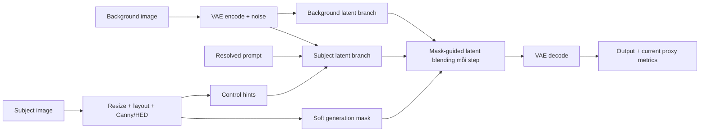
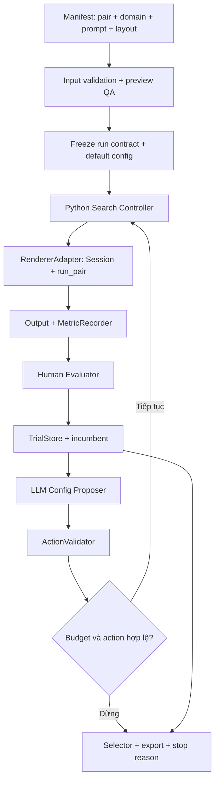
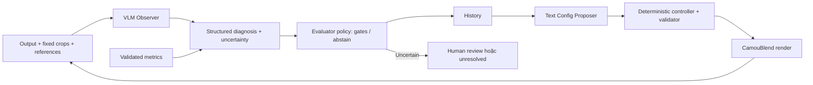
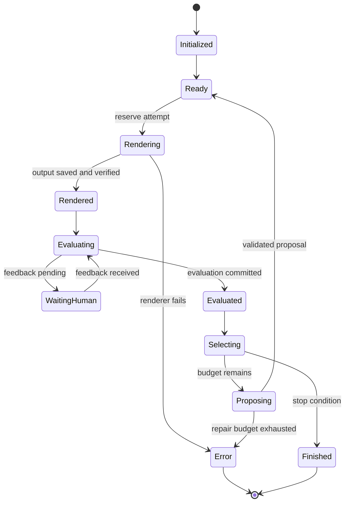

# PRD — CamouBlend: tối ưu cấu hình với phản hồi thị giác

Phiên bản: 1.1 · Ngày: 03-10-2026 · Trạng thái: đặc tả triển khai và nghiên cứu, chưa phải tính năng đã hoàn thành.

## 0. Cách dùng tài liệu

Đây là tài liệu quyết định phạm vi hiện tại. Nếu mô tả trong các kế hoạch cũ khác tài liệu này, dùng PRD này làm chuẩn. Các mốc thực hiện và task có ID nằm ở [MILESTONES_CAMOUBLEND.md](MILESTONES_CAMOUBLEND.md).

Tài liệu bổ trợ:

- [Chọn input khi chưa có ảnh mẫu](INPUT_SELECTION_PLAN.md).
- [Golden set, audit configs và annotation](GOLDEN_SET_GUIDE.md).

Quy ước:

- **Đã có:** xác nhận từ code hiện tại, không mặc định đã benchmark trên mọi domain.
- **Cần xây:** yêu cầu của phiên bản mới.
- **Đề xuất pilot:** con số/setting cần kiểm tra trên dev, không phải kết quả đo.
- **Gate:** điều kiện hoàn thành mốc; không đạt thì xử lý nguyên nhân hoặc giới hạn claim, không tự tuyên bố hoàn thành.

### 0.1. Kết luận review v1.1 và thứ tự đọc

**Kiến trúc hợp lý để triển khai; chưa có bằng chứng agent cải thiện chất lượng/tốc độ.** Bản review này chốt model/backend, bỏ split pilot cũ và tách các phép đánh giá cần người chưa từng thấy subject khỏi chấm structure có reference.

| Finding | Hành động trong v1.1 |
|---|---|
| Tên model còn để mở | Chốt GPT-5.4 mini snapshot cho Proposer và Observer, Responses API; xem §17 |
| Split 8/4/6 xung đột ma trận dev 18 pairs | Dùng duy nhất 18 dev pilot → dev120/val30/test100; không split lại 18 pairs |
| `wrong_identity` dễ gây hiểu nhầm portrait | Đổi thành animal-only `wrong_category`; portrait không identity score |
| Chấm every-trial first-view đòi quá nhiều raters | Primary first-view ở final selected outputs; trajectory quality là secondary reference-aware study |
| `load_rgb` stretch trực tiếp về canvas | Chuẩn hóa/crop giữ tỷ lệ trước khi đưa vào loader; lưu crop transform, không đổi giữa methods |
| `Generation.steps_run` không được forward vào `PairResult` | Task instrumentation M0/M3 để log measured steps; chưa sửa sampling |
| `requirements.txt` chỉ có lower bounds | Tạo runtime lock từ GPU smoke đã pass, ghi package versions; không coi lower bounds là reproducibility |
| Controller quá nhiều lựa chọn khởi đầu | Fixed initializer, 3-key grid, N=5/10, JSONL và Python state machine |

Đọc PRD để biết **chốt cái gì**, milestone plan để biết **làm theo thứ tự nào**, input plan để **thu ảnh**, golden guide để **chấm và lưu labels**. Không tạo thêm một roadmap cạnh tranh với bốn tài liệu này.

## 1. Tóm tắt sản phẩm và nghiên cứu

CamouBlend nhận ảnh subject và ảnh background, tạo ảnh có subject hòa vào background bằng diffusion không train lại weights. Hiện người dùng phải render, nhìn ảnh, sửa config rồi thử lại.

Phần mở rộng giúp chọn cấu hình theo từng pair bằng một vòng thử nghiệm có lịch sử, giới hạn ngân sách và feedback có cấu trúc. Giữ nguyên generator chính; xây lớp điều phối và đánh giá quanh generator.

**Mục tiêu thị giác:** subject hòa nền đẹp nhưng nhận ra ngay. Với động vật, nhận ra đúng nhóm/loài ở granularity đã định. Với human portrait, giữ hình dáng khuôn mặt người hợp lý; **không yêu cầu giữ danh tính người nguồn**.

**MVP:** Python controller + human evaluator + một LLM Config Proposer, có random/rule baselines để so sánh.

**Phiên bản sau MVP:** thêm VLM Observer đã được calibration; Proposer tiếp tục nhận feedback dạng text/JSON. Hai vai trò không có nghĩa bắt buộc hai VLM hoặc hai backbone khác nhau.

## 2. Những quyết định đã chốt

| ID | Quyết định |
|---|---|
| D01 | Subject chỉ thuộc hai domain: animal và human_portrait |
| D02 | Portrait cần recognizable face/face structure và integration; không tối ưu identity similarity |
| D03 | Output cần nhận ra ở lần nhìn đầu; không tối ưu concealment tối đa |
| D04 | Background có thể là ảnh chụp, 2D illustration/pattern hoặc raster render 3D |
| D05 | Chưa có bộ outputs mẫu; phải thu input và render audit trước |
| D06 | Giữ SD/ControlNet/dual-latent generator, không train/fine-tune trong MVP |
| D07 | Ban đầu search ba tham số: bg_strength, alpha_end, softedge_scale |
| D08 | Prompt, layout, generation mask policy, seed và model settings được khóa trong mỗi run |
| D09 | Human labels là cơ sở phát triển evaluator; metric proxies chưa là reward đáng tin mặc định |
| D10 | Pilot N=5; benchmark chính N=10 gồm initial render; báo prefix 1/3/5/10 |
| D11 | Khoảng 5 giây/render là số người dùng báo; end-to-end cost cần đo lại |
| D12 | Cả triển khai kỹ thuật và nghiên cứu phải chứng minh giá trị trước baseline đơn giản |
| D13 | Proposer/Observer dùng `gpt-5.4-mini-2026-03-17`, Responses API, reasoning none |
| D14 | Observer có hai passes tách context; Proposer text-only; Python quyết định render/stop |
| D15 | Core test: default + random + rule + proposed; primary 100 pairs/1 seed, repeat 20 pairs/seed thứ hai |
| D16 | Main target data: dev120/val30/test100; 18 pilot pairs chỉ là phần dev |
| D17 | Final first-view human study và reference-aware trajectory study là hai endpoints khác nhau |
| D18 | Không thuê/chạy API hoặc GPU trả phí tự động từ tài liệu; preflight và chi phí được kiểm tra ở implementation |

Giữ nguồn chân dung trong một split để tránh leakage từ ảnh gần trùng/cùng người; đây là kiểm soát dữ liệu, không phải thêm nhiệm vụ nhận dạng danh tính.

## 3. Người dùng và tình huống sử dụng

### 3.1. Người dùng chính

- Tác giả nghiên cứu: chuẩn bị input, chạy experiments, phân tích failures và viết luận văn/paper.
- Người hướng dẫn: xem mục tiêu, architecture, ví dụ và bằng chứng so sánh.
- Người đánh giá: chấm output theo protocol, không cần hiểu tham số diffusion.

### 3.2. User stories

| ID | Nhu cầu | Kết quả mong muốn |
|---|---|---|
| US01 | Chọn hai ảnh và kiểu subject | Tạo run với input/prompt/layout có thể tái lập |
| US02 | Xem preview trước khi render | Phát hiện sai edge, crop hoặc mask sớm |
| US03 | Chạy default rồi nhận hỗ trợ tuning | Đề xuất thay đổi nhỏ, có bằng chứng từ trials |
| US04 | Chấm ảnh nhanh | Accept/reject/uncertain + failure tags + preference |
| US05 | Dừng hoặc session bị ngắt | Giữ outputs/logs và resume không render lại ảnh đã hoàn tất |
| US06 | Lấy kết quả cuối | Output, config, trạng thái accept và chi phí rõ ràng |
| US07 | So agent với phương pháp đơn giản | Cùng pair/seed/budget và báo cả failure |
| US08 | Kiểm tra từng domain | Báo riêng animal/portrait, nền ít/nhiều texture và style |

## 4. Phạm vi

### 4.1. Trong MVP

- Động vật và chân dung một người; ảnh raster 2D làm input/output.
- Chọn subject label từ metadata, không phụ thuộc tên file.
- Fixed background task, cho phép thay đổi vùng chèn theo quy tắc đã freeze.
- Discrete config search, fixed initialization, một candidate mỗi lượt.
- Human feedback, metrics logging, history và bounded LLM proposal.
- Baselines default/random/rule/ordered subset và controlled human tuning.
- Manifest-driven selected pairs, không mặc định Cartesian batch.
- CLI/research scripts và tích hợp tối thiểu vào Gradio hiện có.
- Export kết quả phục vụ Kaggle và review offline.

### 4.2. Ngoài MVP

- Đồ vật như chìa khóa/cốc/lá làm subject; toàn thân người hoặc nhiều subject.
- Face identity preservation, face recognition reward hoặc identity-conditioned model.
- Mesh, video, multi-view, 3D consistency.
- Fine-tuning generator/reward model; RL; prompt search đồng thời với config search.
- Agent tự thay code, mask policy, layout hoặc evaluator.
- Hệ nhiều agent tranh luận, vector database, cross-run learning/retrieval.
- Hứa hẹn một cấu hình luôn phù hợp mọi background.

Các chức năng ngoài MVP chỉ mở bằng một experiment/PRD revision riêng có lý do, không tự thêm để chữa từng failure.

## 5. Tiêu chí ảnh đạt

### 5.1. Tiêu chí chung

Một output accepted cần: recognizable ngay + integration đủ tốt + structure hợp lý + background preservation + không artifact nghiêm trọng. Không cần trùng một target image duy nhất.

| Trục | Animal | Human portrait |
|---|---|---|
| Recognition | Đúng nhãn/nhóm đã chốt | Nhận ra khuôn mặt người; không hỏi người đó là ai |
| Structure | Thân, chi, cánh/đuôi và đặc trưng liên quan không lỗi nghiêm trọng | Mắt/mũi/miệng, outline mặt và tỷ lệ phù hợp góc nhìn |
| Source relation | Giữ cấu trúc/pose cần thiết; appearance được đổi để hòa nền | Giữ hình dáng và hướng mặt ở mức hợp lý; không yêu cầu đúng người nguồn |
| Integration | Không nổi như sticker; appearance phù hợp nền | Mặt hòa nền nhưng vẫn đọc được, không halo/seam rõ |
| Background | Giữ vùng nền ngoài evaluation exclusion region | Giống animal |

Mặt góc nghiêng có thể chỉ thấy một mắt; không viết rule “phải thấy hai mắt” cho mọi portrait. Texture thay đổi màu da/lông không tự là lỗi nếu phù hợp nhiệm vụ và vẫn giữ structure.

### 5.2. Rubric và labels

- `acceptance`: accept / reject / uncertain.
- Ratings 1–5 có anchors: integration, structure, background preservation, overall quality; cho phép not_assessable.
- Tags chung: subject_missing, subject_too_hidden, subject_too_visible, wrong_structure, background_damaged, artifact.
- Animal: wrong_category nếu không đúng nhãn yêu cầu.
- Portrait: face_structure_error; **không dùng identity_drift làm failure hoặc reward**.
- Preference: candidate / incumbent / tie / uncertain. Thắng một ảnh xấu chưa nghĩa là đạt.

Không tự cộng ratings ordinal thành scalar reward trước calibration. Giữ raw votes và consensus version.

### 5.3. Hai lượt human evaluation

Lượt A chỉ xem output chưa có tên/prompt/reference để đo nhận dạng. Lượt B mới hiện subject/background để đánh giá structure/integration/preservation. Người đã biết subject không cung cấp phép đo recognition không gợi ý.

Đề xuất thử first-view window 3 giây trên dev, chốt protocol trước test; không gọi 3 giây là ngưỡng khoa học đã xác thực. Nếu chưa có UI đo thời gian, chỉ báo first-view judgment, không bịa reaction time.

Không cho cùng rater xem nhiều biến thể cùng pair trước khi hoàn tất first-view task. Randomize/blind method labels. Pilot có thể lấy tác giả + người hướng dẫn để viết rubric; final evaluation cần raters độc lập với việc tuning, đề xuất 3 ratings/output trong tập được chấm và giữ bất đồng.

## 6. Kiến trúc hiện tại — đã có trong repository



Sơ đồ rút gọn; coupling/schedules theo code hiện tại. Subject branch không phải direct VAE encoding của subject image; không được diễn giải thành cơ chế bảo toàn face identity.

| Thành phần hiện có | Vai trò | Cách dùng trong PRD |
|---|---|---|
| `camo/config.py` | Dataclass config, overrides, validation | Giữ config generator; thêm search policy riêng |
| `camo/preprocess.py` | Resize/layout, edge maps, soft mask, HED cache | QA và wrap; không đổi thuật toán tùy từng method |
| `camo/generator.py` | SD1.5, ControlNets, hai latent branches | Giữ nguyên trong MVP |
| `camo/runner.py:Session` | Giữ heavy models và stop flag | Reuse một Session cho serial renders |
| `camo/runner.py:run_pair` | Chạy một pair, trả PairResult, lưu assets | Entry point của RendererAdapter |
| `camo/presets.py` | Variant overrides và grids | Reuse cách áp config; search whitelist riêng |
| `camo/ui.py`, `ui_canvas.py` | Gradio và layout controls | Thêm tab Search/Annotation, không dựng app mới |
| `camo/metrics.py`, `clip_score.py` | Metrics đang có | Legacy diagnostics; chưa là evaluator chính |
| `camo/cli.py` | run/batch/sweep/preview | Add explicit manifest/search commands sau |

Hạn chế cần xử lý tại adapter:

1. `all_pairs()` tạo mọi subject × background; benchmark mới phải đọc manifest chọn lọc.
2. Current metrics dùng generation mask; cần scorer với evaluation assets độc lập.
3. `PairResult.seconds` chưa đại diện toàn latency; cần timer ngoài run_pair. `Generation.steps_run` có trong generator nhưng chưa được forward/lưu bởi PairResult; thêm field instrumentation, không suy measured steps chỉ từ config.
4. `bg_strength` thay effective steps, không chỉ appearance.
5. HED cache hiện dựa path/shape; input nên immutable, hash được log. Nếu thay file cùng path, invalidation/recreate preprocessor; không reuse stale cache.
6. Session load models từ config ban đầu; không cho Proposer thay checkpoint/device trong cùng session.
7. `load_rgb` dùng convert RGB rồi resize thẳng về kích thước yêu cầu; không tự giữ aspect ratio hoặc composite alpha. Chuẩn hóa input một lần thành RGB canvas 512×512 sau crop/pad giữ tỷ lệ, kiểm tra mặt không méo và lưu transform. Chọn chính sách crop/pad theo domain trên dev rồi khóa cho mọi method; không kéo giãn mặt hoặc âm thầm mất alpha.
8. `requirements.txt` lower bounds không đủ khóa runtime. Sau GPU smoke, export exact installed versions và checkpoint resolved revisions/hashes vào environment lock. Không nâng dependency giữa benchmark.

### 6.1. Quy trình bắt buộc cho alpha và mask leakage

**Xác minh từ code:** `imageio.load_rgb` gọi `convert("RGB")` nên bỏ alpha, không composite lên nền quy định; vùng transparent có RGB ẩn màu gì sẽ giữ màu đó, không luôn đen. `Preprocessor.prepare` tạo mask từ HED của toàn ảnh; `build_soft_mask` blur → gamma → floor/ceiling, không có foreground constraint. README ghi 95% pixel mask >0.05 trên một ảnh thử cũ; đây không phải tỷ lệ đo lại trên data hiện tại, không đủ kết luận portrait rò hơn animal.

Bỏ alpha và leakage là hai vấn đề liên quan nhưng khác nhau: sửa composite không bảo đảm HED mask hết rò. Không đẩy lỗi preprocessing cho agent bằng cách mở thêm mask.gamma trong search.

**P0 — chuẩn bị input trước M1:**

1. Giữ bản gốc. Với PNG có alpha, lưu `source_alpha.png` trước RGB conversion, kiểm tra alpha có phản ánh subject hay chỉ toàn 1.
2. Composite có chủ đích trên nền xám trung tính RGB(128,128,128), rồi crop/pad giữ tỷ lệ thành 512×512. Lưu RGB, alpha đã transform, transform metadata và hashes. Không chỉ convert RGB. White-background variant chỉ là audit riêng trên dev, không thay màu tùy output đẹp.
3. Với ảnh opaque đã có nền sạch, dùng trực tiếp sau normalization và QA. Với ảnh opaque nền rối, đặt một lớp xám phía sau không xóa được nền cũ: cần mask/cutout thủ công hoặc segmentation mới composite được. Nếu chưa làm, gắn `preprocess_pending`, không giả là clean input.
4. Run preview HED/Canny/mask trên normalized RGB; xem bằng mắt ở full frame và crop. Giữ cả asset trước/sau xử lý, không mất provenance.

**P1 — nếu normalized input vẫn rò ở M1:**

- Ưu tiên alpha/cutout mask đã có và đã review. Tạo foreground support cùng transform; chỉ cân nhắc learned segmentation nếu thiếu support đáng tin.
- Model segmentation dự phòng đã chọn: **`ZhengPeng7/BiRefNet`**. Chạy offline để chuẩn bị assets, cache predictions, review tóc/tai/chi mảnh; không load cùng diffusion mỗi trial. Chốt revision và dependencies khi kích hoạt. Đây là model segmentation, không phải ground truth và không bảo đảm đúng mọi portrait/animal. [Official model card](https://huggingface.co/ZhengPeng7/BiRefNet)
- Phiên bản `preprocess.v2` có thể giới hạn generation mask bằng soft foreground support sau layout: `M_gen = M_HED * G_soft`. Dilation/feather quanh support được cố định trên dev; kiểm tra không cắt tóc/tai/vây hoặc phá internal edges. Nếu background edges vẫn điều khiển ControlNet, thử gate hints bằng cùng support trong một ablation có version, không sửa ngầm.
- Giữ `preprocess.v1` = explicit composite + normalized RGB + original HED mask. Chỉ chọn v2 cho main benchmark sau dev QA/regression; mọi method trong benchmark dùng cùng phiên bản và assets. Data thu với v1/v2 không gộp không nhãn; rerender affected comparisons nếu đổi version.

**Đo leakage, không chỉ nhìn total mask coverage:** với G là foreground region đã review và có margin cố định, ghi `outside_mass = sum(M*(1-G))/sum(M)` và `outside_active = count((M>0.05) & outside(G))/count(outside(G))`. Zero denominators trả null + reason. Ghi raw/final masks nếu đã gating; tỷ lệ sau gate nhỏ không tự chứng minh mask tốt. Whole-frame coverage 95% có thể liên quan subject rất lớn nên phải xem G/overlay trước khi kết luận.

QA gate: không có cấu trúc nền rõ bị lấy nhầm làm subject, không mất bộ phận quan trọng, support/edges/layout thẳng hàng; discrepancies phải review trước batch. Dùng các số leakage làm diagnostic và freeze numeric alert thresholds trên dev nếu cần, không đặt chúng thành automatic quality reward.

**Phân biệt ba assets:** A_input (alpha/cutout nguồn), M_gen (mask render), E_eval (evaluation regions đã review và freeze). E_eval không cập nhật theo proposal hoặc segmentation dự đoán mỗi trial. Có thể dùng input annotation đã review để xây E_eval một lần nhưng phải giữ version/hash riêng, không alias với M_gen.

**Lý do giữ bước này trong MVP:** explicit alpha handling và QA là data integrity; conditional segmentation là sửa preprocessing có kiểm soát, không thay kiến trúc diffusion. Nếu không giải được leakage ở một domain, báo feasibility gap trước khi đầu tư thêm agents.

## 7. Kiến trúc mới — lớp tối ưu quanh generator

### 7.1. MVP



### 7.2. Phiên bản có VLM



Final independent human evaluation nằm ngoài loop và không được đưa labels ngược vào search. Deployment và nghiên cứu dùng cùng renderer nhưng stopping/selection protocol được ghi rõ.

### 7.3. Trách nhiệm hai vai trò

| Vai trò | Đầu vào | Đầu ra | Không làm |
|---|---|---|---|
| Observer, khi đã thêm | Output, fixed ROI crops, subject/background references ở pass thích hợp, rubric | Recognition/structure/integration diagnosis, tags, evidence, uncertain | Chọn arbitrary config, sửa ROI/rubric, kết luận identity |
| Config Proposer | Evaluated history, costs, allowed actions, remaining budget | Parent trial, một action, evidence trial IDs, hypothesis ngắn | Tự render, chỉnh prompt/mask/model hoặc phát minh metric values |

Observer per-image có thể chấm blind trước khi xem optimizer hypothesis để hạn chế confirmation bias. Reference-aware observer không được coi như human first-view recognition. Khi nghiên cứu trajectory visual reasoning, thêm ảnh cũ có ID rõ và coi đó là ablation riêng.

Không cần Hint Agent riêng trong MVP: Proposer trả `trajectory_summary` và proposal trong một call. Không cần ReAct cho state machine cố định. Cùng một backbone có thể phục vụ hai roles sau này; vẫn phải log từng call và cost.

## 8. Modules, interfaces và cấu trúc code đề xuất

Các đường dẫn mới dưới đây là **đề xuất, chưa tồn tại**; không phải lệnh đã có thể chạy.

```text
camo/
  generator.py, preprocess.py, runner.py, ...    # existing
  search/
    schema.py            # typed contracts, schema versions
    manifest.py          # source groups, explicit pair list, hash validation
    policy.py            # allowed values/actions and immutable fields
    renderer.py          # wraps Session/run_pair, timing/artifacts
    history.py           # append-only events, atomic snapshots, recovery
    controller.py        # bounded state machine, retries/stop/resume
    selector.py          # incumbent, feasible shortlist, return status
    proposers.py         # random, ordered, rule, LLM adapters
    model_client.py      # configurable text/vision backend + call logging
  evaluation/
    schema.py            # evidence, raw/consensus annotations
    assets.py            # fixed ROI/background region, coordinate QA
    metrics.py           # versioned diagnostic scorers
    human.py             # pending-feedback adapter
    observer.py          # optional VLM observer
    policy.py            # optional calibrated gates/abstention
  ui_search.py           # thin callbacks/views reused by existing Gradio
configs/search/
  pilot.yaml
  benchmark.yaml
  evaluator.yaml
scripts/
  audit_pairs.py
  collect_annotations.py
  run_benchmark.py
  analyze_search.py
tests/
  test_search_policy.py
  test_search_resume.py
  test_evaluation_assets.py
benchmarks/               # manifests/protocol versions, selected assets
outputs/search/          # generated runs/artifacts; separate from source
```

Bắt đầu với số file tối thiểu, tách module khi code đủ lớn; sơ đồ thể hiện ranh giới trách nhiệm, không yêu cầu tạo mọi file rỗng ngay.

```python
# Proposed interfaces; not current runnable APIs.
load_cases(manifest_path) -> list[CaseSpec]
freeze_run(case, generator_config, search_policy) -> RunContract
render(session, contract, candidate_config, attempt_id) -> RenderArtifact
measure(artifact, fixed_eval_assets, metric_policy) -> MetricRecord
evaluate(artifact, context, protocol) -> Evaluation | PendingHuman
propose(history, legal_actions, remaining_budget) -> Proposal
validate_apply(proposal, contract, history) -> Candidate | ProposalError
select(history, selector_policy) -> Selection
export_run(run_id) -> ArtifactBundle
```

Renderer success không đồng nghĩa evaluation success. Missing metric trả null + reason, không đổi thành 0. Không để LLM điền measured runtime/hash/steps vào authoritative fields.

## 9. Functional requirements và nghiệm thu

| ID | Priority | Requirement | Nghiệm thu |
|---|---|---|---|
| FR01 | P0 | Explicit pair manifest với animal/portrait domain | Chạy đúng IDs yêu cầu, không mở rộng Cartesian ngoài ý muốn |
| FR02 | P0 | Freeze input/config/prompt/ROI/seed versions | Mọi trial truy được về run contract; mutation bị chặn |
| FR03 | P0 | Preview QA và đánh dấu input hợp lệ | Có debug artifacts; invalid input có reason trước GPU render |
| FR04 | P0 | RendererAdapter reuse Session | Không reload diffusion mỗi trial; outputs và full config được lưu |
| FR05 | P0 | Action whitelist và finite/bounds validation | Invalid proposals không đi tới renderer |
| FR06 | P0 | Human feedback có uncertain/tie | Resume cùng output sau chấm; không render lại khi đang chờ |
| FR07 | P0 | Budget, stop và checkpoint | Không vượt số physical attempts; final attempt vẫn được chấm khi resume |
| FR08 | P0 | History giữ cả failures | Có order/parent/action/feedback/cost cho mọi attempt |
| FR09 | P0 | Selector minh bạch | selected ID, accepted status và stop reason cùng export |
| FR10 | P0 | Random/rule/ordered baselines | Cùng runner/search contract; method seeds tách render seed |
| FR11 | P1 | LLM JSON proposal và bounded repair | Không arbitrary config; retry/cost được log; exhaustion dừng rõ |
| FR12 | P1 | Fixed-region metrics | Generation mask changes không tự thay evaluation region |
| FR13 | P1 | Benchmark analysis | Animal/portrait breakdown, selected accept, success/cost và failures |
| FR14 | P2 | VLM Observer có abstain | Calibration report trước auto-use; reference priming được ghi |
| FR15 | P2 | Automatic gates/selector | Frozen versions và human false-accept analysis trên validation |
| FR16 | P1 | Export/recovery Kaggle | Portable bundle gồm relative paths/hashes; restart kiểm tra artifacts |
| FR17 | P1 | Blind annotation view | Không lộ method/config/target label trước first-view response |
| FR18 | P0 | Explicit alpha composite, aspect-ratio normalization và leakage QA | PNG transparent không dùng hidden RGB như nền; lưu alpha/transform; affected methods chung preprocess version |

## 10. Non-functional requirements

- Reproducibility: ghi model/code/config/environment revisions, input hashes, backend model settings. Same-seed check trong cùng môi trường; không hứa pixel-identical trên mọi GPU/library.
- Reliability: atomic writes cho output metadata và snapshots; single writer/run trong MVP; phát hiện event cuối bị cắt do session interruption.
- Efficiency: reuse model Session; metrics/API latency đo riêng; không gọi VLM khi evaluator human-only.
- Portability: manifests không hard-code host paths; source root/output root resolve tại runtime.
- Cost control: cap render attempts, model calls và time ở config; human waiting tách khỏi active compute timer nhưng vẫn nằm trong elapsed time.
- Integrity: immutable evaluation assets trong run; no silent fallback/method switch, no unlabeled mixed versions.
- Data access: test annotations không trong proposer context; API keys ở environment/secrets, không trong export.
- Observability: UI hiển thị trial count, pending state, last action, output, incumbent và stop reason; technical debug details ở log/research view.

Không đặt latency SLA khi chưa đo GPU cụ thể. 5 giây/render là baseline assumption cần audit; model calls có thể làm system chậm hơn random.

## 11. Search policy và initialization

### 11.1. Initial config

Trial đầu dùng fixed default chung: bg_strength=0.52, alpha_end=0.54, softedge_scale=1.50, theo config hiện tại. Hint/history trống; không cần gọi LLM để khởi tạo.

Preset theo input và LLM init là ablations sau. Khi so refiner, cấp cùng initializer cho các methods hoặc báo factorial initializer × refiner; không gộp gain từ preset thành gain của trajectory.

### 11.2. Action space đề xuất pilot

| Key | Allowed levels | Phần còn lại |
|---|---|---|
| sampling.bg_strength | 0.42, 0.47, 0.52, 0.57, 0.62 | Khóa total steps/scheduler; log effective steps |
| blend.alpha_end | 0.36, 0.42, 0.48, 0.54, 0.60, 0.66 | Khóa blend profile/start/end |
| control.softedge_scale | 0.90, 1.10, 1.30, 1.50, 1.60 | Khóa các ControlNet settings khác |

150 combinations, không render hết. Bounds là prior từ repo và kế hoạch pilot; phải kiểm tra trên dev trước freeze. Giữ mask.gamma và guidance ngoài action space MVP.

Proposer chọn parent trial đã evaluated, một key, direction up/down một level. Action `keep` chỉ dùng trong deployment để chọn incumbent/không render. Trong fixed-budget research, không đưa keep vào legal actions nếu còn config chưa thử; không dừng sớm chỉ vì model đã hài lòng. Rebase về trial cũ được phép. Endpoint ngoài grid trả validation error, không silent clipping.

Config identity bao gồm all frozen inputs + effective render settings + seed. Duplicate policy chặn config đã render cùng seed; effective-step dedup chỉ áp dụng khi đã chứng minh settings tương đương trong renderer, không suy từ một trường riêng lẻ.

Random global lấy chưa lặp từ toàn grid để tạo baseline mạnh. Random-neighbor dùng cùng one-key transitions cho reasoning ablation. Ghi rõ khác biệt này; same bounds không có nghĩa same transition policy.

### 11.3. Rule baseline v1 đã chốt để implement

Đây là heuristic ban đầu, không phải tác động tham số đã chứng minh. Rules chỉ thấy cùng structured feedback mà LLM thấy; không đọc final-test labels.

1. `subject_missing` hoặc `subject_too_hidden`: từ incumbent thử tăng alpha_end một mức; nếu không còn legal thì tăng softedge_scale.
2. `wrong_structure`, `wrong_category` hoặc `face_structure_error`: tăng softedge_scale; nếu hết mức thì thử tăng alpha_end.
3. `background_damaged`: giảm bg_strength.
4. `subject_too_visible`/sticker: giảm alpha_end; nếu không legal thì giảm softedge_scale.
5. Feedback uncertain/all-feasible mà research budget còn: thử next untried coordinate theo thứ tự alpha_end, softedge_scale, bg_strength, directions down rồi up; có thể rebase về evaluated parent khác theo trial ID.

Áp dụng thứ tự trên khi nhiều tags cùng có; ghi rule ID/action. Nếu action đầu trùng/ngoài grid, tìm next legal candidate theo thứ tự cố định, không render lại. Tag artifact không kèm diagnosis cụ thể dùng coordinate schedule ở bước 5. Validation có thể sửa rule trên dev rồi freeze `rule.v2`; không sửa giữa test.

### 11.4. Budget và stopping

| Setting | Quy tắc |
|---|---|
| Smoke pilot | Max 5 render attempts gồm default |
| Main benchmark | Max 10, fixed budget nếu không lỗi/cancel/action exhaustion |
| Deployment/HITL | Cho phép dừng khi người xác nhận accept |
| API repair | Tối đa 2 repair calls sau proposal không hợp lệ, sau đó dừng invalid_proposal |
| API transport retry | Tối đa 1 retry cho transient failure trong call cap; log cả hai |
| Render error | Attempt đã reserved vẫn được tính; default dừng error, không retry miễn phí |
| Duplicate proposal | Repair trong cap; hết cap dừng action_exhausted/invalid_proposal |
| User stop | Dừng qua Session stop cơ chế hiện có; checkpoint, status cancelled |
| Evaluation unavailable | PendingHuman nếu chờ được; otherwise unresolved/error, không tự pass |

Các retry limits là engineering defaults đề xuất, có version và có thể sửa trên dev. Benchmark dừng sớm vì lỗi phải báo incomplete; không gọi đó là tiết kiệm cost đạt quality.

Ví dụ search policy đề xuất cho MVP; đây là schema mới, chưa phải config generator hiện có:

```yaml
schema_version: search_policy.v1
mode: research
initializer: fixed_default
max_render_attempts: 10
max_model_calls: 30
max_proposal_repairs: 2
max_transport_retries_per_call: 1
render_error_policy: stop
evaluator: human
selector: human_incumbent
allow_cross_pair_memory: false
```

`max_model_calls` tính cả failed calls/transport retries, là tổng cap bổ sung ngoài per-proposal limits; chạm cap thì dừng rõ, không nới tự động để đủ 10 renders. V1 có Observer dùng policy khác được freeze trước study, báo costs riêng. Time/token monetary caps thêm theo environment và audit thực, không viết con số latency giả.

## 12. State machine và resume



Cancelled state có thể đến từ bất kỳ state hoạt động; lưu reason và artifacts đã hoàn thành. Resume không tạo run mới trừ khi contract thay đổi.

Recovery precedence:

1. Nếu có output verified nhưng chưa đánh giá, hoàn tất evaluation trước khi kiểm tra quyền allocate render mới; kể cả đó là attempt cuối.
2. Nếu có evaluated trial nhưng chưa có proposal, khôi phục incumbent và propose chỉ khi còn budget.
3. Nếu rendering bị ngắt không có output hợp lệ, đánh dấu interrupted attempt và tính cost đã dùng; không tự render lại với cùng attempt ID.
4. Nếu có pending config hợp lệ nhưng chưa reserve, tiếp tục reserve khi còn budget.
5. Hash/version mismatch: reject resume, yêu cầu tạo run mới từ dữ liệu hợp lệ; không trộn lịch sử.

Conceptual loop:

```python
state = load_or_initialize(contract)
while True:
    if state.has_verified_pending_output():
        evaluation = evaluate_or_wait(state.pending_output)
        if evaluation.pending:
            checkpoint_and_return_pending()
        commit_evaluation_and_update_selection(evaluation)
        state = reload_state()
        continue

    if should_finish(state, run_mode, budgets):
        return finalize_selection(state)

    config = fixed_default if state.is_first_trial else bounded_propose(state)
    validate_config_and_no_duplicates(config)
    attempt = reserve_and_checkpoint(config)  # consumes render slot
    try:
        artifact = render_from_original_inputs(attempt)
        save_and_verify_output(artifact)
    except RenderError as error:
        record_attempt_error(error)
        return finalize_incomplete(state)
    state = reload_state()
```

Full implementation phải xử lý PendingHuman/unavailable/cancel trong evaluator và persistent proposal state. Không dùng ảnh output trước làm input sinh tiếp trừ khi nghiên cứu một phương pháp khác.

## 13. Selection policy

MVP human-assisted: sau mỗi candidate, người chấm acceptance và preference so incumbent. Incumbent update theo protocol; giữ mọi accepted candidate và raw comparisons. Không giả định pairwise preference hoàn toàn bắc cầu.

Nếu có accepted candidate, selector ưu tiên accepted rồi preference. Nếu chưa có, có thể xuất diagnostic incumbent với `accepted=false`; không gọi best-so-far là đạt. Tie policy freeze, ví dụ giữ incumbent để tránh gratuitous changes.

V1 automatic: feasible gates trước, sau đó objective hoặc calibrated preference. Uncertain không được tự biến thành feasible. Nếu cần người chọn cuối, log human time và gọi method human-assisted.

Research ghi selected ID tại từng prefix N=1/3/5/10, không dùng labels offline của các trial tương lai để chọn ngược ảnh tại prefix trước.

## 14. Data contracts và lưu trữ

### 14.1. Các entities

| Entity | Trường bắt buộc chính |
|---|---|
| Subject | id, domain, label, source_group, file hash/path, style, pose/shape tags, nguồn |
| Background | id, source_group, path/hash, representation, content, texture tags |
| Pair | id, split, subject/background IDs, local ROI tags, layout/prompt/eval assets versions |
| Run | id, contract hash, pair, method/version, initializer, budgets, seed policy, generator/backend revisions |
| Attempt | unique id, config hash/full config, seed, timestamps, render status/artifacts/errors/cost |
| Trial | attempt link, parent/action, metric record, evaluation refs, incumbent snapshot |
| Annotation | rater, protocol, first-view/reference flags, labels/ratings/tags/raw response |
| ModelCall | role/backend/version, input refs/hash, output/parse status, latency/tokens/cost/retries |
| Selection | selected trial, accepted flag, selector version, stop reason, prefix |

Physical attempt và trial không bị gộp khi retry; GPU failure vẫn được accounting. Cache reuse ghi logical evaluation count và physical cost riêng.

### 14.2. Example proposal

```json
{
  "schema_version": "proposal.v1",
  "parent_trial_id": "t003",
  "action": {
    "key": "control.softedge_scale",
    "direction": "decrease_small"
  },
  "evidence_trial_ids": ["t002", "t003"],
  "trajectory_summary": "Outline vẫn quá nổi sau khi tăng control.",
  "hypothesis": "Giảm control một mức có thể làm biên tự nhiên hơn."
}
```

Hypothesis là giả thuyết, không measurement hay causal proof. Backend map direction sang value; model không gửi full config tùy ý.

### 14.3. Example evaluation

```json
{
  "schema_version": "evaluation.v1",
  "trial_id": "t003",
  "domain": "human_portrait",
  "source": "human",
  "acceptance": "reject",
  "recognition": {"result": "face_recognizable", "reference_shown": false},
  "failure_tags": ["face_structure_error", "subject_too_visible"],
  "ratings": {"integration": 2, "structure": 2, "background_preservation": 4},
  "evidence": "Vùng miệng méo và viền má nổi tách khỏi nền.",
  "preference_vs_incumbent": "incumbent",
  "rubric_version": "rubric.v1"
}
```

Đây là ví dụ schema, không phải label đã thu. Identity không là field đánh giá bắt buộc. Không suy nhân khẩu học từ ảnh để điền metadata.

### 14.4. Storage MVP

```text
benchmarks/<dataset_version>/
  subjects.jsonl, backgrounds.jsonl, pairs.jsonl
  protocols/, evaluation_assets/
outputs/search/<run_id>/
  run.json, events.jsonl, state.json
  attempts/<attempt_id>/config.yaml, output.png, result.json, debug/
  metrics.jsonl, online_annotations.jsonl, model_calls.jsonl
  selections.jsonl, summary.json, export_manifest.json
evaluation_private/<study_id>/
  blind_mapping.json, final_annotations.jsonl, comparisons.jsonl
```

Relative paths trong bundle, hashes để verify. Events append-only, snapshots atomic, raw output không overwrite. Private final annotations không nằm trong files mà Proposer được cấp.

## 15. Data plan: từ chưa có mẫu đến benchmark

### 15.1. Đợt A — audit nhỏ

6 subjects: mèo, thằn lằn, bướm, cá, portrait chính diện, portrait góc 3/4 của người khác. 6 backgrounds: tường ít texture, cát, lá dày, vân gỗ, đá render 3D có provenance, geometric pattern 2D.

18 dev pairs theo [ma trận input](INPUT_SELECTION_PLAN.md). Ba pairs audit: mèo–cát, portrait chính diện–tường, portrait góc 3/4–lá dày. 7 configs/pair = 21 renders; chạy default 15 pairs còn lại = 36 renders tổng. Đây chỉ là smoke/sensitivity study.

Nếu chưa có rendered_3d input, ghi coverage missing; ảnh chụp trông có khối không được tự đổi nhãn thành render 3D.

### 15.2. Quy mô v1 thống nhất

| Stage | Số pairs | Animal / portrait | Vai trò |
|---|---:|---:|---|
| Pilot | 18 | 12 / 6 | Là subset dev, không phải split độc lập |
| Dev v1 | 120 | 60 / 60 | Phát triển preprocessing/rubric/rules/prompt, calibration |
| Validation v1 | 30 | 15 / 15 | Frozen evaluator check và release gate |
| Locked test v1 | 100 | 50 / 50 | Primary evaluation sau freeze |

Tổng 250 pairs, pilot 18 không cộng thêm. Đây là **planning target đã chọn**, không bảo đảm power thống kê hay cover mọi tình huống. Nếu nguồn/raters chưa đủ, chạy pilot và ghi rõ scope; không âm thầm đổi denominator của benchmark v1.

Thu khoảng 30–50 subject images và 30–60 backgrounds cho dev, ghép chọn lọc 120 pairs. Val/test phải dùng source groups mới, không chỉ crop khác từ nguồn dev. Group portrait cùng người khi metadata nguồn cho biết; không thêm face recognition để suy group. Nếu không xác minh được groups thì ghi limitation, không claim unseen identities.

### 15.3. Coverage quota

Định nghĩa chín cells trong từng domain: 3 mức local texture (low/medium/high) × 3 representation groups (photo / 2D illustration-pattern / rendered-3D).

- Dev: 6 pairs/cell/domain = 108 pairs; thêm 6 hard-but-valid pairs/domain = 12, tổng 120.
- Validation: 1 pair/cell/domain = 18; thêm 6/domain vào cells thiếu đa dạng nguồn, tổng 30.
- Test: 5 pairs/cell/domain = 90; thêm 5 hard-but-valid/domain = 10, tổng 100.

Các additional pairs là nhiệm vụ thật, không phải background-only/blur controls. Hard tags được định từ input/đặc trưng cấu trúc trước method outputs. Content (wall/sand/foliage/wood/stone/pattern) cân đối trong phạm vi có thể, nhưng representation không bị đồng nhất với một material. Một nguồn có thể tạo nhiều pairs trong cùng split; phân tích phải account clustering.

Đây là coverage sampling, không phải factorial causal experiment. Chưa claim ảnh 3D khó hơn 2D chỉ từ aggregate differences; matched-content study là extension riêng. Nếu thiếu rendered-3D sources, đánh dấu coverage gap và hoàn tất trước claim đầy đủ v1, không relabel photographs.

### 15.4. Số outputs cần thu theo đợt

1. Dev: default 120 pairs. Audit 12 dev pairs (6/domain), mỗi pair thêm 6 configs so default → 192 outputs tối đa; ba pairs audit đầu nằm trong 12, không chạy lại cùng contract.
2. Manual development trajectories: 6 dev pairs (3/domain), N=5 gồm default; thêm tối đa 24 renders → 216 outputs, trước dedup/cache. Feedback ghi thật trước/sau từng action.
3. Validation: 30 pairs × 3 configs cố định trước xem kết quả (C00, C03, C06 trong audit grid) → 90 natural outputs. Thêm 24 controls cân bằng domains, log riêng và không gộp vào natural acceptance rate.
4. Locked test chỉ render theo study §19, không sweep rồi chọn các pairs agent làm tốt.

Chấm reference-aware để phát triển/kiểm định observer, còn first-view cuối giữ riêng. Không tái dùng calibration labels làm held-out validation. Nếu observer/policy được sửa sau fail validation, phiên bản mới cần validation cases mới hoặc ghi rõ repeated-validation adaptation; locked test vẫn giữ kín.

### 15.5. Quy tắc collection

Ảnh bị loại vì lỗi kỹ thuật cần reason; ảnh hợp lệ nhưng renderer kém phải giữ. Source/style/crop/layout/preprocess versions trong manifest. Split theo source groups trước render; ảnh thuộc cả animal/portrait gầntrùng và backgrounds chung nối thành groups cần account trong stats.

Input hiện chưa được thu. Các quotas là kế hoạch việc làm, không phải dataset đã có hoặc số trường hợp đã chứng minh thành công.

## 16. Evaluation và metric strategy

### 16.1. Primary outcomes

| Metric | Định nghĩa và lưu ý |
|---|---|
| SelectedAccept@N | Tỷ lệ output hệ thống thật sự trả về ở prefix N được independent humans chấp nhận |
| Success@N | Tỷ lệ run có ít nhất một accepted trial trong N; cần labels các trial trong prefix |
| Recognition | Animal đúng label; portrait nhận ra mặt người, không hỏi identity |
| Generations-to-Success | Trial đầu accepted; unsuccessful runs censored ở budget, không bỏ khỏi mẫu |
| Time-to-Success | Online elapsed time tới first accepted trial, tách compute/API/human active/wait |
| Human active time | Thời gian xem/chọn/chỉnh/feedback, không đánh đồng với thời gian chờ render |
| Cost | Physical GPU seconds, effective steps, failed attempts, API tokens/cost |
| Final preference | Blind paired preference selected outputs, có tie/uncertain và cả hai không đạt |

Primary nghiên cứu: HumanSelectedAccept@10 trên main seed; human active time ở user-workflow study riêng. Prefix 1/3/5/10 được log nhưng chỉ gọi human metric khi có đủ labels theo protocol; main full-test first-view study không chấm mọi prefix. Success@N và selection gap giải thích search vs selector.

Báo riêng animal/portrait; nếu cần điểm tổng dùng macro-average hai domain và công bố weighting. Style/texture breakdown chỉ diễn giải khi đủ mẫu, báo n và CI.

### 16.2. Diagnostic metrics

| Metric | Cách dùng | Giới hạn |
|---|---|---|
| SSIM_bg_fixed | Weighted SSIM map trên fixed background region | Grayscale chưa bao phủ màu; local windows cần margin không lẫn subject |
| Color difference diagnostic | Trên cùng fixed region, same scale/colorspace | Hữu ích phát hiện đổi màu nhưng chưa tự là accept gate |
| CLIP full/crop/gain | Neutral frozen text theo domain; crop I/B cùng ROI | Không thay recognition, không đo identity; style cần calibration |
| S_b | Đo boundary contour visibility theo implementation version | Không đo overall quality hoặc presence |
| Existing S_edge/hidden_score | Giữ dưới tên legacy diagnostics | Không coi là S_b hoặc human camouflage quality |

Không thêm FID/KID làm per-trial reward cho vài ảnh không có target distribution rõ. Không dùng face identity embeddings trong scope này.

### 16.3. S_b và fixed evaluation assets

Định nghĩa tham khảo: S_b = 1 − F1(m_b ⊙ C_gt, m_b ⊙ C), với m_b = dilate(m) − erode(m). Điểm cao thể hiện contour ít trùng boundary subject, không bảo đảm subject tồn tại. Nguồn: [The Making and Breaking of Camouflage](https://arxiv.org/html/2309.03899v1), [CAMEVAL](https://github.com/hlamdouar/CAMEVAL).

Phải version detector/threshold/crop/morphology và empty-contour handling. Fixed expected ROI không phải GT silhouette thực của mọi generated output. Trên calibration subset, review actual contour/mask để đo mismatch. Subject absent: recognition gate fail; không dùng ROI giả để gọi S_b hợp lệ.

Đặc biệt với portrait, outer face boundary tốt không bảo đảm cấu trúc mắt/mũi/miệng tốt. Face structure phải được đánh giá riêng. S_b áp dụng cho portrait là transfer cần validate, không mặc định kết quả literature động vật áp dụng nguyên vẹn.

### 16.4. Từ human sang automatic evaluation

1. Human-only decisions; metrics chỉ log.
2. Human + diagnostic metrics và failure taxonomy; kiểm tra correlation/false accepts.
3. VLM Observer + human calibration; có abstain và domain breakdown.
4. Automatic feasibility gates + objective/preference, chỉ khi validation hỗ trợ.

Objective đề xuất: maximize integration subject to recognition/structure/background/quality constraints. Chưa chốt trọng số/threshold bằng trực giác. Nếu scalar không đáng tin, dùng feasible/Pareto shortlist và human selector; Pareto membership không có nghĩa ảnh đạt.

Gates acceptance cần tolerance và CI được preregister trên dev/validation trước locked test. Không đưa một ngưỡng CLIP chung cho animal/portrait khi chưa calibration. VLM confidence tự khai không phải calibrated probability.

Controls: background-only, sticker, blur/noise, malformed face/animal, ROI mismatch. Auto system không được pass background-only chỉ vì preservation cao. Report false-accept rate/abstention/coverage, không chỉ agreement tổng.

### 16.5. Quy tắc quyết định v1 và release gate của Observer

Không dùng S_b/CLIP thresholds trong auto acceptance v1. Observer B trả từng criterion `pass/fail/uncertain`: structure, integration, background preservation, no_severe_artifacts; ratings dùng xếp hạng và giải thích. Observer A cung cấp blind subject description. Local policy so A với accepted labels đã freeze.

- Auto-accept khi recognition matches và mọi criterion B pass, không uncertain.
- Nếu có criterion fail: reject; nếu không fail nhưng có uncertain/unmatched alias: abstain.
- Selector ưu tiên feasible, rồi tuple ordinal `(integration, structure, background_preservation)` giảm dần, tie giữ trial sớm hơn. Đây là preference policy versioned, không scalar reward hay human ground truth; kiểm tra selection gap.
- Human final accept: ít nhất 2/3 raters đánh giá first-view recognition đúng **và** tất cả tiêu chí chất lượng đạt. Uncertain không tính là accept; report uncertainty riêng.

Gate để dùng auto acceptance trong nghiên cứu có giám sát: trên 90 validation natural outputs, precision của auto-accept ≥90% overall và trong từng domain; có ít nhất 30 auto-accepted outputs tổng, ít nhất 15/domain; auto-decided coverage ≥50% overall và ≥40% mỗi domain. Không auto-pass control có missing subject hoặc structure lỗi nghiêm trọng theo labels độc lập. Report false accepts/rejects và CI; không suy “an toàn 90%” từ sample nhỏ.

Các ngưỡng này là **release tolerances thiết kế**, không empirical findings hoặc chuẩn chung của lĩnh vực. Freeze trước xem validation outcomes; nếu không đủ positive outputs/n, trạng thái insufficient evidence và giữ HITL. Categorical rubric/anchors phải được người hướng dẫn review trên dev. Không hạ ngưỡng sau khi thấy model fail chỉ để qua gate.

MVP không phải chờ gate này: Proposer + human evaluator vẫn là deliverable độc lập. Nếu automatic gate fail, main study gọi đúng human-assisted và cập nhật rater/time workload trước preregistration, không mô tả như full-auto.

## 17. Model stack và API contract đã chốt

### 17.1. Cấu hình chính

| Thành phần | Model/checkpoint hoặc công cụ | Nơi chạy | Quyết định |
|---|---|---|---|
| Diffusion | `stable-diffusion-v1-5/stable-diffusion-v1-5` | GPU Kaggle | Giữ model hiện tại |
| Canny ControlNet | `lllyasviel/sd-controlnet-canny` | GPU Kaggle | Giữ current weights/config |
| SoftEdge ControlNet | `lllyasviel/control_v11p_sd15_softedge` | GPU Kaggle | Giữ current weights/config |
| HED | Weights từ `lllyasviel/Annotators`, loader `camo/hed.py` | Session Kaggle | Giữ preprocessing đã có |
| Segmentation dự phòng | `ZhengPeng7/BiRefNet` | Offline preprocessing | Chỉ kích hoạt nếu không có alpha/cutout tốt và M1 cần sửa leakage; xem §6.1 |
| CLIP diagnostic | `openai/clip-vit-base-patch32` | Session Kaggle | Log proxy; không nhận dạng danh tính |
| Config Proposer | **`gpt-5.4-mini-2026-03-17`** | OpenAI Responses API | Text-only, JSON schema strict |
| VLM Observer | **`gpt-5.4-mini-2026-03-17`** | OpenAI Responses API | Image+text, hai passes, cùng snapshot |
| Controller / metrics | Python, NumPy/OpenCV; JSONL + atomic snapshots | Kaggle/local | Không cần agent framework |
| Final judge | Người chấm độc lập | Annotation UI | Không lấy model làm ground truth cuối |

Model IDs diffusion/ControlNet/HED/CLIP được đối chiếu với `configs/default.yaml`. Khi download ở M0, lưu resolved checkpoint revision và file hash; không tự bịa commit SHA chưa tải.

GPT-5.4 mini có image input, Structured Outputs và Responses API; official docs liệt kê snapshot trên và reasoning effort `none`. Dùng cùng backbone cho hai roles để giảm confound model capacity. Đây là lựa chọn kỹ thuật cho workflow, không phải claim nó đã được benchmark tốt nhất trên camouflage. [Official model documentation](https://developers.openai.com/api/docs/models/gpt-5.4-mini)

Giá standard được tra ngày 03-10-2026: input $0.75, cached input $0.075, output $4.50 trên một triệu tokens. Dùng usage thực để tính; giá không phải ngân sách đã được người dùng chi. Chưa kiểm tra quyền truy cập API/billing của tài khoản. [Model pricing](https://developers.openai.com/api/docs/models/gpt-5.4-mini)

**Không chạy VLM local hoặc mở cuộc thi model selection trong tuyến chính.** Việc này giảm VRAM/model-swapping risk khi GPU Kaggle chưa xác định. Nếu không có API, vẫn hoàn thành audit, golden set, random/rule và human baseline; chưa claim đã hoàn thành LLM/VLM module. Thay backend về sau là experiment/version mới, không silent fallback giữa run.

### 17.2. Settings của lời gọi

| Setting | Proposer | Observer A: output-only | Observer B: diagnosis |
|---|---|---|---|
| Model | Cùng snapshot ở trên | Cùng snapshot | Cùng snapshot |
| reasoning.effort | none | none | none |
| max_output_tokens | 700 | 400 | 1.200 |
| Image inputs | Không | Một output full frame | Năm ảnh theo contract bên dưới |
| Image detail | N/A | high | high |
| Structured output | proposal.v1 strict JSON | observation_blind.v1 strict JSON | diagnosis.v1 strict JSON |
| Transport timeout | 45 giây/call | 45 giây/call | 45 giây/call |
| Controller retry | Tối đa 1 transient transport retry/call | Như Proposer | Như Proposer |
| Tools của model | Không external tools; context được prefill | Không | Không |

Không gửi temperature/top_p nếu chưa được compatibility test và freeze; `reasoning:none` không làm output deterministic. SDK auto-retry tắt để controller accounting không bỏ sót requests. `max_output_tokens` là cap engineering, không dự đoán tokens sử dụng; incomplete/truncated/refusal response là unavailable/repair theo policy, không parse thiếu rồi accept.

Dùng Responses `text.format` với `type=json_schema`, `strict=true`, closed object schema; local semantic validation vẫn kiểm tra IDs, finite values và legal actions. Schema adherence không bảo đảm diagnosis đúng. [Structured Outputs](https://developers.openai.com/api/docs/guides/structured-outputs)

### 17.3. Image/context contract

**Pass A:** output nguyên bản, không target label/domain/prompt/reference/ROI overlay. Hỏi mô tả chủ thể đọc được, trả `observed_subject`, `face_present`, `uncertain`. Không xem đây là human recognition measurement; target matching làm sau bằng frozen aliases hoặc uncertain, không hỏi model tự xác nhận nhãn đã được gợi ý.

**Pass B:** fresh request, không conversation state từ Proposer. Nhận domain/target và năm ảnh có IDs:

1. `output_full`: output trên canvas đã khóa.
2. `background_full`: nền sau cùng normalization/layout contract.
3. `structure_reference`: subject đã align cùng canvas, thể hiện cấu trúc cần giữ; không đòi copy màu/identity.
4. `output_roi`: crop theo fixed expected ROI.
5. `background_roi`: cùng crop trên nền gốc để so appearance/preservation.

Không dùng contact sheet chữ nhỏ làm input chính. `Prepared.subject` hiện là ảnh trước layout; phải tạo reference aligned đúng transform, không lấy nó làm ảnh đã align. Không đưa method/config/hypothesis hoặc human final-test labels vào Observer. Không dùng previous_response_id để vô tình mang context từ pass A/B hoặc pair trước.

PNG RGB; full frame theo canvas 512×512; crop giữ tỷ lệ, không enlarge để giả thêm chi tiết. Vision inputs có token cost, nên log payload dimensions/detail/usage thay vì giả định mỗi ảnh một giá cố định. [Images and vision](https://developers.openai.com/api/docs/guides/images-vision)

Proposer nhận tối đa toàn bộ 10 evaluated trials dạng compact JSON: configs/actions, feedback, costs, incumbent, remaining budget và legal next actions. Không cần retrieval/cross-pair memory. Natural-language explanation ngắn, không yêu cầu hidden chain-of-thought.

### 17.4. Accounting và preflight

N=10 với VLM hai passes/trial và chín proposal steps: **20 Observer calls + 9 Proposer calls = 29 calls** trước retries. MVP human evaluator chỉ có tối đa 9 Proposer calls. Cap toàn run: 30 calls cho MVP, 60 calls cho vision mode; failed/repair/transport calls đều tính vào cap. Rule/random trong cùng-observer study cũng phải tính đủ 20 Observer calls nếu cả 10 trials được chấm.

Preflight trước benchmark: xác nhận snapshot truy cập được, strict schema/vision request chạy được trên dev assets được phép gửi, log response model/request ID và usage; đo median/p95 latency. Chưa có API call hoặc ảnh nào được gửi khi viết tài liệu này.

Nếu VLM validation fail, giữ nó ở diagnosis-only/human review; model đã chốt không có nghĩa evaluator đã valid. Không nâng model giữa locked study để cứu những ảnh khó; revision mới phải qua calibration và rerun công bằng.

## 18. UI và luồng thao tác

### 18.1. Researcher view

1. Chọn subject/background hoặc pair manifest, domain và label.
2. Preview subject, background, edges, mask; đặt layout rồi freeze run.
3. Chọn method, N=5/10 và evaluator mode; xem budget dự kiến, không gọi là runtime cam kết.
4. Start: chạy default, hiện output và trạng thái waiting feedback.
5. Chấm accept/tags/preference; tiếp tục hoặc stop theo run mode.
6. Xem history/thumbnails, config delta và incumbent. Không cho sửa frozen fields giữa run.
7. Export ảnh cuối + config + log + bảng cost; nếu chưa đạt hiển thị rõ.

### 18.2. Blind annotation view

Output-only first-view, nhập recognition trước khi bật references; sau đó ratings/tags. Không hiện filenames có target labels, method names, config, metric score hoặc proposal hypothesis. Left/right pairwise order randomized, lưu mapping riêng.

### 18.3. Proposed CLI

Đây là target interfaces, chưa phải lệnh đã được implement:

```text
python -m camo audit --manifest ... --protocol ...
python -m camo search --manifest ... --pair-id ... --search-config ...
python -m camo resume --run-dir ...
python -m camo benchmark --manifest ... --study-config ...
```

Có thể triển khai bằng scripts trước khi mở rộng CLI choices hiện có. Không viết README như thể commands đã tồn tại khi chưa có tests/smoke run.

## 19. Experiment protocol đã chốt

### 19.1. Core study và optional ablations

| Study | Methods | Pairs / seeds / budget | Endpoint |
|---|---|---|---|
| Core automatic, khi M6 qua gate | Fixed default; random global; rule v1; proposed LLM | 100 test pairs, seed 1234, N=10 cho ba search methods | HumanSelectedAccept@10; cost; domain breakdown |
| Seed sensitivity | Ba search methods | 20 test pairs chọn trước, seed 5678, N=10 | Stability/structure/preservation/cost; không mặc định human first-view |
| Trajectory diagnosis | Ba search methods | 12 test pairs chọn trước, 6/domain, main seed, mọi trial | ReferenceAwareSuccess@N, selection gap, failure progression |
| Human workflow | Manual tuning vs proposed system | 20 test pairs chọn trước, 10/domain, N=10 | Active human time, selected quality và elapsed time |
| History ablation | Proposed no-history vs proposed history | 20 dev/validation study pairs theo frozen protocol, N=10 | Giá trị trajectory; không làm thay main test |
| Transition control | Random-neighbor vs proposed | Cùng 20 ablation pairs | Tách action-policy constraints khỏi reasoning |

Fixed default lấy từ initial trial có cùng contract; không render thêm chỉ để tạo baseline. Nếu cached physical outputs được share, vẫn báo logical budget mỗi method, không claim cache là algorithmic speedup. Report exact number of unique outputs và requests thực.

Ordered subset, TPE và separate Hint Agent không nằm trong core benchmark. Có thể chạy sau nếu core results đặt ra câu hỏi cụ thể. TPE cần numeric objective meaningful và startup phù hợp N; không thêm chỉ để đủ tên baseline.

### 19.2. So sánh công bằng

Random/rule/LLM đều dùng cùng Observer, criterion policy, selector, inputs, prompt, preprocessing, bounds, initial config, render seed và max render budget. Random global được nhảy toàn grid; proposed/rule dùng legal one-key actions. Report rõ và dùng random-neighbor ablation để kiểm tra confound này.

Common observer là phần cost của mọi automatic method, kể cả random. Proposer có thêm calls và phải trả giá latency/token tương ứng. Không dùng human oracle để chọn ảnh tốt nhất cho random rồi gọi đó là deployable random baseline miễn phí.

Human-assisted M4 comparison là experiment khác với automatic core: cùng feedback fields, người nhìn ảnh/đưa feedback hoặc tự chọn action. Không gộp hai study thành một bảng claim fully automatic.

### 19.3. Primary final-output human study

100 pairs × 4 methods (default + 3 search) = **400 selected image slots** ở main seed. Mỗi slot có 3 independent ratings → **1.200 rating assignments** trước dedup. Rater xem một variant của mỗi pair/source group trước first-view response, rồi chấm reference-aware quality ngay sau đó. Không cho xem method/config/metric/hypothesis.

Cần thiết kế 12 counterbalanced schedules nếu mọi selected slot đều có 3 first-view ratings: 4 variants × 3 raters. Planning minimum là 12 rater slots cho mỗi pair; actual number of distinct people có thể lớn hơn khi test pairs chia sẻ subject/person sources. Assignment generator phải ràng buộc source-group exposure; nếu không đủ người, giảm primary panel/subset trước chạy và gọi exploratory, không dùng rater đã bị primed như fresh observer.

Giả sử mỗi assignment mất 30 giây (giả định cần pilot), tổng khoảng **10 giờ công chấm**; không phải 10 giờ của một người. Shared sources/dedup/missing raters làm scheduling khác nhau. Final annotations private, không đưa vào search.

### 19.4. Secondary trajectory study

12 pairs × 3 search methods × 10 trials = tối đa **360 trajectory output slots**; 3 ratings/slot → 1.080 assignments. Với 20 giây/reference-aware assignment, khoảng 6 giờ công chấm theo giả định, trước dedup.

Raters biết target/reference ở study này, nên gọi `ReferenceAwareSuccess@N` và `ReferenceAwareSelectedAccept@N`, không đánh tráo thành immediate-recognition Success@N. Full-test prefix curves dùng Observer labels phải tên `ObserverSuccess@N`. Main human recognition claim dựa final-output study §19.3.

Không thể thu first-view độc lập cho mọi trial bằng việc để ba người xem lặp lại tất cả variants của cùng subject. Nếu muốn endpoint đó, cần một study và rater budget riêng.

### 19.5. Human-workflow study

20 pairs được chọn trước khi xem outcomes, cân bằng domain. Manual condition cùng bounds/renderer/seed/N; người tự chọn action. Assisted condition dùng chosen proposed system, đo mọi thao tác người nếu HITL hoặc setup/selection nếu automatic. Counterbalance pair/condition giữa operators để không học từ condition trước; mọi ảnh cuối chấm độc lập.

Không claim tiết kiệm công chấm nghiên cứu từ việc automatic loop không có người. Online active time, waiting time, offline annotation labor là ba trường riêng.

### 19.6. Freeze và phân tích

- Main seed 1234; sensitivity seed 5678; optimizer random seeds log riêng. Same seed không làm mọi stochastic path giống hệt khi strength/schedule khác.
- Fixed-budget research không early-stop khi đã có accept; stop chỉ do budget/cancel/error/action exhaustion, report incomplete rõ.
- Primary effect: proposed − strongest simple baseline trên HumanSelectedAccept@10, kèm paired/source-group-aware 95% CI. Target vận hành để theo dõi là khoảng +10 điểm phần trăm hoặc giảm ≥25% active human time ở chất lượng không giảm rõ; đây là goals, không power guarantee hoặc kết quả hứa trước.
- Báo animal/portrait riêng, macro-average hai domain, n và uncertainty. Nếu CI không đủ rõ, kết luận exploratory/no demonstrated improvement.
- Khi nguồn lặp, bootstrap theo groups/components chia sẻ subject/background hoặc báo source-level uncertainty; không lấy 10 trials/2 seeds thành independent n.
- Không tune model/rule/threshold theo locked test. Bugs ảnh hưởng kết quả cần version change và rerun affected comparisons, giữ audit trail.

## 20. Resource plan cụ thể

| Hoạt động | Render count trước cache | Với 5 giây/render, chỉ phần render |
|---|---:|---:|
| Initial audit | 21 | 105 giây |
| Initial audit + 15 default coverage | 36 tổng | 3 phút |
| Dev default + 12-pair audit + 6 manual trajectories | Tối đa 216 | 18 phút |
| Validation natural outputs | 90 | 7,5 phút |
| Core test 100 × 3 search × 10 | 3.000 | 4 giờ 10 phút |
| Seed sensitivity 20 × 3 × 10 | 600 | 50 phút |
| Manual comparator 20 × 10 | Tối đa 200 | 16 phút 40 giây |
| Hai extra ablation methods × 20 × 10 | Tối đa 400 | 33 phút 20 giây |

Core + sensitivity = **3.600 renders, khoảng 5 giờ phần render**, chưa gồm API/metrics/load/retry/annotation. Baseline default nằm trong initial trials. Human comparator và extra ablations là phần thêm riêng. Render count này không gồm mọi iteration phát triển; ghi actual consumption.

Vision mode core: mỗi pair có 20 Observer calls cho mỗi search method, LLM thêm 9 proposal calls; 100×(20+20+29)=6.900 calls trước cache/retries. Sensitivity thêm 1.380 calls. Tính cả shared default/reused metric/observer cache theo hash nếu triển khai, nhưng báo số thật và không lợi dụng cache để claim search nhanh hơn.

Ví dụ lập ngân sách API, không phải dự báo usage: nếu tổng actual input tokens I=30 triệu (đã gồm image tokens) và output O=4 triệu, ở standard rate đã tra thì chi phí $22.50+$18=$40.50, chưa cache discount/retries hoặc thay giá. Thay I/O bằng logs đo từ 12-pair pilot trước khi chạy lớn; không lấy “29 calls” nhân một giá/call cố định.

Gate budget trước M7: có số đo warm/cold median/p95 render/API, actual token usage, số raters xác nhận và giới hạn chi thực tế của người dùng. Việc chọn model trong PRD không tự cho phép phát sinh chi phí. Không dùng model lớn cùng Kaggle GPU để né API mà không làm lại compute plan.

Ước tính annotation main final + trajectory khoảng **16 giờ công chấm** với assumptions ở §19, chưa gồm data collection, consensus và development. Vì vậy rater availability có thể là critical path hơn diffusion GPU.

## 21. Verification plan

### 21.1. Tests bắt buộc khi implement

- Whitelist, finite values, endpoint action, immutable config fields.
- Selected pair manifest, duplicate IDs/source hashes và grouping checks.
- Budget accounting khi render success/failure/cancel/retry.
- Resume final attempt chờ human feedback không rerender.
- Proposal invalid/duplicate không vượt repair cap hoặc âm thầm switch method.
- Fixed evaluation assets không thay theo generation mask; zero-area returns unavailable.
- Geometry/coordinate registration giữa output/background/ROI.
- Transparent pixel giữ hidden RGB khác nhau nhưng normalized composite giống nhau; alpha được giữ, opaque RGB không bị xử lý như RGBA cutout.
- Foreground support transform khớp layout; gating không xóa tai/tóc/chi mảnh trên reviewed fixtures.
- Pending/unavailable metrics không tự thành 0 hoặc accept.
- Selector không báo success khi chưa có accepted trial.
- Blind view không lộ target/method trước lượt A.

### 21.2. Regression và smoke

Reuse `tests/test_core.py` và `tests/test_generator_tiny.py` khi thay code integration liên quan; bổ sung focused tests cho contracts/state. GPU smoke trên 1 animal + 1 portrait; full 21-render audit ở data milestone. Không chạy full benchmark cho mỗi thay đổi UI/documentation.

Documentation-only PRD hiện tại chưa chạy GPU tests và chưa triển khai agent. Verification ở đây là kế hoạch nghiệm thu cho các mốc sau.

## 22. Milestones và release gates

| Mốc | Sản phẩm chính | Gate |
|---|---|---|
| M0 — Scope/audit | Frozen baseline contract, timing, input inventory schema | Scope rõ; baseline có thể chạy và log |
| M1 — Input pilot | 6 subjects, 6 backgrounds, 18 dev pairs, 21→36 outputs | QA và observed failures, có rubric anchors nếu generator tạo được |
| M2 — Data/evaluation | Golden dev v1, rubric, fixed ROI, human logs | Labels/process có thể dùng; splits không leakage |
| M3 — Baselines/controller | Random/rule/human, bounded controller, resume/export | Functional tests + comparable pilot runs |
| M4 — LLM MVP | One Proposer, structured history, cost | No-history/rule comparison; report benefit or null result |
| M5 — Metric validation | S_b/CLIP/SSIM/control study | Quyết định metric nào chỉ diagnostic, metric nào có thể vào gates |
| M6 — Optional vision | VLM Observer + calibrated evaluator | Validation support, abstain; không đạt thì giữ human-assisted |
| M7 — Locked study | Frozen methods, blinded test, subgroup/cost results | No test tuning; report selected/trajectory distinction |
| M8 — Delivery | Code/data protocol/report/slides/reproduce guide | Claim đúng implemented/evaluated scope; known limits rõ |

M0→M1→M2→M3→M4 là tuyến MVP. M5 có thể bắt đầu khi M2 có labels. M6 phụ thuộc M5/validation và không bắt buộc để M7 nghiên cứu human-assisted. Chi tiết tasks, deliverables, acceptance và việc làm khi gate fail ở [milestone plan](MILESTONES_CAMOUBLEND.md).

## 23. Risks và decision rules

| Risk | Dấu hiệu | Quyết định |
|---|---|---|
| Generator không giữ cấu trúc portrait | Nhiều failures ở tất cả configs | Audit input/preprocess và giới hạn năng lực; không hứa agent tự sửa |
| Nền phẳng khó hòa mà vẫn recognizable | Sticker hoặc mất subject | Giữ cases, phân tích trade-off, không chuyển mục tiêu sang concealment |
| Human rubric thiếu nhất quán | High disagreement/uncertain | Bổ sung anchors, sửa protocol trên dev, giữ raw votes |
| Proxy reward hacking | Absent/blur/noise có điểm tốt | Chặn bằng validation/gates hoặc bỏ proxy khỏi loop |
| LLM không hơn rule | Same quality, higher latency/cost | Chọn rule hoặc giới hạn contribution của LLM |
| API chậm hơn render tiết kiệm | End-to-end time tăng | Báo rõ; giảm calls hoặc giữ human/rule pathway |
| Dataset nhỏ/source lặp | CI rộng, subgroup ít mẫu | Thu nguồn mới hoặc hạn chế claim |
| Automatic selector bỏ lỡ ảnh tốt | Success@N cao, SelectedAccept thấp | Sửa selector trên dev, không sửa theo test |
| Trộn identity vào portrait quality | Chấm khác người thành fail | Nhắc D02; chỉ chấm structure/integration theo scope |

## 24. Research framing và giới hạn claim

RATTPO là cảm hứng history/feedback/proposal; CamouBlend optimize config, dùng human/multi-criteria feedback và budget nhỏ. Không gọi là tái hiện nguyên bản. Nguồn: [RATTPO](https://arxiv.org/html/2506.16853v1).

Contribution dự kiến: protocol và dữ liệu cho recognizable animal/portrait blending trên fixed background; constrained trajectory-guided config search; bằng chứng giảm search/human cost ở quality tương đương. Chúng là giả thuyết nghiên cứu cần chứng minh, không phải novelty đã xác nhận.

“Thêm hai agents” không tự là contribution. Không gọi training-free là không cần calibration data. Không gọi human-assisted là fully automatic. Không gọi face-shape preservation là identity preservation.

### 24.1. Đối chiếu các công trình liên quan

Related work kiểm tra ở mức kiến trúc, chưa là systematic novelty proof:

| Work | Liên quan và ranh giới cần phân biệt |
|---|---|
| [RATTPO](https://arxiv.org/html/2506.16853v1) | Prompt/history/hint/reward loop đã có; đổi sang theta riêng không đủ claim algorithm mới |
| [SIDiffAgent](https://arxiv.org/html/2602.02051v1) | Có generation/evaluation/guidance và experience memory; visual feedback + memory không mới tự thân |
| [GenPilot](https://arxiv.org/html/2510.07217v1) | Prompt optimization với error analysis, verification và memory; cần tách novelty khỏi multi-agent refinement |
| [GenArtist](https://arxiv.org/html/2407.05600v1) | MLLM điều phối công cụ generation/editing và self-correction; CamouBlend giữ một renderer/action space nhỏ |
| [TTGen](https://openaccess.thecvf.com/content/CVPR2025W/ViSCALE/html/Qiao_TTGen_Incorporating_Test-time_Scaling_to_Diffusion_Models_CVPRW_2025_paper.html) | Refine prompt và chọn latent trajectory trong sampling; phạm vi khác outer-loop config search |
| [FreeCam](https://arxiv.org/html/2609.14377v1) | Frozen inpainting giữ foreground, sinh background dựa trên multimodal reasoning/appearance. Không tương đương nhiệm vụ giữ supplied background |
| [CamoDreamer](https://arxiv.org/html/2607.17768v1) | Decoupled object/background control và frequency blending; ý tưởng hai luồng/decoupling không được claim rộng là mới |
| [CT-CIG](https://arxiv.org/abs/2511.20218) và [repo](https://github.com/NikoNairre/CT-CIG) | VLM tạo prompt dataset, finetune diffusion/controller; không phải cùng training-free configuration-search setting |

Nếu claim chỉ “thêm VLM vào diffusion” thì novelty yếu. Hướng khả thi hơn là kết hợp: (a) benchmark/protocol human-calibrated cho recognizable fixed-background camouflage, (b) constrained visual/trajectory search trong low budget, (c) bằng chứng giảm render hoặc thao tác người so baseline mạnh, có cost matched analysis. Cả ba là candidate contributions, chưa được chứng minh mới hay hiệu quả. Muốn tăng method novelty mà giữ scope: thiết kế policy chọn sửa tham số theo failure có kiểm chứng, uncertainty-aware abstention, explicit rebase/interaction recovery; so với rule và optimizer truyền thống. Những kỹ thuật đó riêng lẻ cũng không tự động novel.

Hai lớp experiments tách biệt: search methods cùng CamouBlend trả lời controller có ích; generator methods như FreeCam/CT-CIG chỉ so khi input/region preservation hợp nhau hoặc công bố adapted setting. Không bắt FreeCam giữ một background nó vốn được phép sinh rồi dùng SSIM kết luận kém.

## 25. Definition of done toàn dự án

### Release MVP

- [ ] Hai domain có input/output/labels thật và protocol rõ.
- [ ] Generator unchanged hoặc mọi bug fix có regression và áp dụng chung methods.
- [ ] Controller/proposer/baselines chạy bounded, logs đầy đủ, resume được.
- [ ] Human feedback và selector không che uncertainty/failure.
- [ ] So sánh MVP với random/rule/human cùng setting; có cost breakdown.
- [ ] Không requirement identity, không silent prompt/layout search.

### Research package

- [ ] Frozen dataset/protocol/config/model revisions và source groups.
- [ ] Locked test và independent human evaluation, báo riêng domains.
- [ ] Primary outcomes, selected-vs-found gap, failures, costs và CI.
- [ ] Ablations đủ để giải thích module nào có ích; null results được giữ.
- [ ] Reproduction scripts/instructions và qualitative panels cả success/failure.
- [ ] Slides phân biệt existing generator, implemented controller và optional future modules.

## 26. Việc bắt đầu ngay sau PRD

1. Thu 6 subject images và 6 backgrounds theo input plan; chưa cần có output đẹp.
2. Lưu labels/domain/source groups và QA ba pairs audit.
3. Freeze prompt/negative prompt phù hợp từng domain trên dev, giữ version; chưa cho agent sửa prompt.
4. Chạy 21 renders, lưu full config/debug/timing và xem failure theo domain.
5. Chọn ảnh neo từ outputs, chốt rubric với người hướng dẫn.
6. Chỉ sau đó mở rộng golden set và implement baseline controller.

Chưa cần câu trả lời bổ sung để bắt đầu các việc này. Model/backend đã chốt ở §17. GPU/runtime cụ thể, hiệu lực numeric gates và sample-size nếu mở rộng sẽ được xác minh tại milestone tương ứng trước locked test; không còn bỏ mở tên model.
